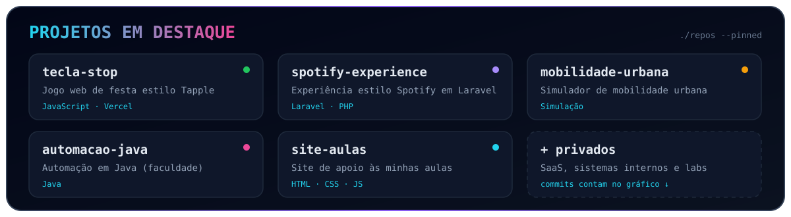

  

<h3 align="center">
  <samp>
    &gt; Olá! Eu sou
    <b><a href="https://github.com/Joao-Vitor-Duarte-Goncalves">João Vitor Duarte Gonçalves</a></b>
  </samp>
</h3>

 

<samp>
「 Desenvolvedor Full Stack construindo sistemas web com Laravel, PHP e MySQL 」
</samp>

  
  
  

  

# 🛠 Tecnologias e Projetos

<table border="0" cellspacing="10" cellpadding="0">
<tr>

<td width="380" valign="top" align="center">

<h3>🛠 Tecnologias</h3>
 

<table align="center" cellspacing="0" cellpadding="6">
  <tr>
    <td align="center"></td>
    <td align="center"></td>
    <td align="center"></td>
    <td align="center"></td>
  </tr>
  <tr>
    <td align="center"></td>
    <td align="center"></td>
    <td align="center"></td>
    <td align="center"></td>
  </tr>
  <tr>
    <td align="center"></td>
    <td align="center"></td>
    <td align="center"></td>
    <td align="center"></td>
  </tr>
</table>

</td>

<td width="560" valign="top" align="center">

<h3>🧪 Projetos</h3>
 

</td>

</tr>
</table>

  

<!-- Estes cards leem o calendário de contribuições do GitHub. Commits privados só aparecem
     com "Include private contributions on my profile" ligado em Settings > Public profile. -->

  

  

  

  

<table width="100%" border="0" cellspacing="10" cellpadding="0">
<tr>

<td width="50%" valign="top">

<h2>🤝 Colaboração</h2>

Aberto a colaborar em:

<ul>
  <li>Sistemas web com Laravel</li>
  <li>Produtos SaaS</li>
  <li>Jogos e ferramentas web</li>
  <li>Projetos de ensino de tecnologia</li>
</ul>

</td>

<td width="50%" valign="top" align="center">

<h2>📫 Contato</h2>

 

  

<!-- LinkedIn: troque SEU-USUARIO e descomente

-->

</td>

</tr>
</table>

⚡ Construindo sistemas web, um commit de cada vez

  

